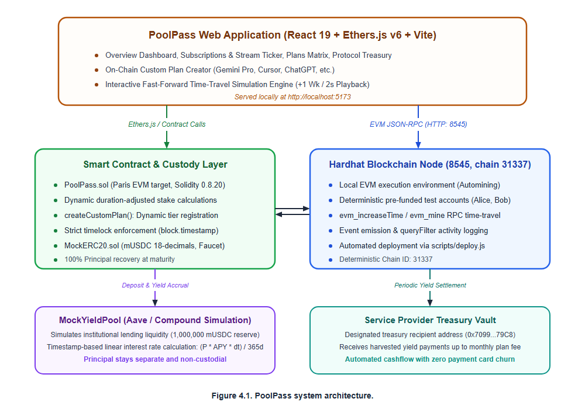
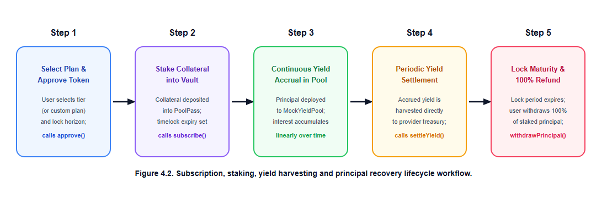

# JAYPEE INSTITUTE OF INFORMATION TECHNOLOGY, NOIDA
## DEPARTMENT OF COMPUTER SCIENCE & ENGINEERING AND INFORMATION TECHNOLOGY

---

# PROJECT REPORT
# POOLPASS: A BLOCKCHAIN-BASED YIELD-FUNDED SUBSCRIPTION SYSTEM
## Decentralized Recurring Service Subscriptions via Smart Contract Lending Yield Routing, Duration-Adjusted Collateralization, and Non-Custodial Principal Recovery

---

| SUBMITTED BY | SUBMITTED TO |
| :--- | :--- |
| Madhav Gairola (Enrollment No. 9924010400XX) | Satya Prakash Patel |
| Project Group / Lab Batch: B.Tech (CSE & IT) | Faculty Guide |

Course Name: Fundamentals of Blockchain Technology Lab  
Course Code: 26B16CS317  
Programme: B.Tech. (Computer Science and Engineering / Information Technology)  
Academic Session: 2026–27 (2026 ODD SEM)  
Project Repository: https://github.com/madhavgairola/poolpass.git  

---

## TABLE OF CONTENTS

| SECTION | SUBSECTIONS |
| :--- | :--- |
| Abstract | — |
| Acknowledgement & Declaration | — |
| Certificate | — |
| Chapter 1: Introduction | 1.1 General<br>1.2 Motivation and Scope |
| Chapter 2: Problem Statement & Requirement Analysis | 2.1 Problem Statement<br>2.2 Research Questions and Objectives<br>2.3 Functional Requirements<br>2.4 Non-Functional Requirements |
| Chapter 3: Technical Background | 3.1 Blockchain, Smart Contracts and EVM<br>3.2 DeFi Lending Mechanics and Yield Accrual<br>3.3 ERC-20 Standard and OpenZeppelin Security<br>3.4 Duration-Adjusted Staking Mathematics<br>3.5 Off-Chain and Web3 dApp Stack |
| Chapter 4: Methodology | 4.1 System Architecture<br>4.2 Smart Contract Architecture and State Machine<br>4.3 Staking, Yield Harvesting and Principal Refund Lifecycle<br>4.4 EVM Time-Travel Simulation Engine<br>4.5 Evaluation Criteria |
| Chapter 5: Implementation | 5.1 Smart Contract Layer (PoolPass, MockYieldPool, MockERC20)<br>5.2 Local Hardhat Node and Deployment Pipelines<br>5.3 Automated Integration Testing Suite<br>5.4 Frontend dApp Implementation (React, Ethers.js, Tailwind CSS)<br>5.5 Execution Runbook and Verification Procedure<br>5.6 Project Directory Structure |
| Chapter 6: Results and Discussion | 6.1 Functional Verification and Test Suite Outcomes<br>6.2 Evaluation Against Research Objectives<br>6.3 Economic Comparison: Traditional SaaS vs. PoolPass<br>6.4 Interpretation and Limitations |
| Chapter 7: Conclusion and Future Scope | 7.1 Conclusion<br>7.2 Key Deliverables and Outcomes<br>7.3 Future Scope |
| References | — |

---

## ABSTRACT

Most digital software services today charge a monthly fee using corporate credit cards or payment processors like Stripe. For users, this is an ongoing expense where the money spent is permanently gone. For students, developers, and small teams subscribing to multiple tools—such as GitHub, Claude, Gemini, or hosting providers—these recurring costs quickly add up. At the same time, service providers regularly face payment failures, credit card expiries, and payment gateway transaction fees.

This project presents PoolPass, a decentralized yield-funded subscription protocol built as a Project-Based Learning submission for the Fundamentals of Blockchain Technology Lab (26B16CS317). Instead of paying money out-of-pocket every month, a user deposits stablecoin tokens into a Solidity smart contract vault. The contract routes this collateral to a lending pool, which simulates the mechanics of protocols like Aave and Compound. The interest earned from lending is harvested to pay the service provider their nominal fee, while the user original deposit remains locked in the contract until the agreed lock period ends. Once the period matures, the user can withdraw 100% of their deposit back to their wallet.

The system is implemented using Solidity 0.8.20 and OpenZeppelin contracts running on a local Hardhat node, connected to a React 19 and Ethers.js frontend. The project includes duration-adjusted staking mathematics that reduces the required upfront collateral when users commit to longer lock periods, an on-chain custom plan registry that lets users add any service (such as Gemini Pro for 20 mUSDC per month), an interactive time-travel playback engine for testing multi-week yield accrual locally, and a clean overview dashboard showing total savings and upcoming settlement deadlines. A suite of 11 automated Hardhat tests verifies that user principal cannot be lost, early withdrawals are blocked, and yield settlements route accurately to the treasury.

Keywords: Blockchain, Ethereum, Smart Contracts, Solidity, Hardhat, Decentralized Finance, Yield-Funded Subscriptions, Time-Travel Simulation, ERC-20, Ethers.js, Non-Custodial.

---

## ACKNOWLEDGEMENT & DECLARATION

### Acknowledgement
I express my sincere gratitude to Satya Prakash Patel, our faculty guide, for his continuous guidance, technical advice, and encouragement during this project. I am thankful to the Department of Computer Science & Engineering and Information Technology and Jaypee Institute of Information Technology, Noida, for providing the laboratory resources and academic environment needed to carry out this work.

I also acknowledge the documentation and tools provided by the Ethereum Foundation, OpenZeppelin, Hardhat, and Ethers.js developer communities, which formed the technical foundation for this project. Finally, I thank my peers and family for their feedback and support throughout the semester.

### Declaration
I hereby declare that this project report titled “PoolPass: A Blockchain-Based Yield-Funded Subscription System” is an authentic record of the Project-Based Learning work carried out by me under the supervision of Satya Prakash Patel for the Fundamentals of Blockchain Technology Lab (26B16CS317) at Jaypee Institute of Information Technology, Noida.

To the best of my knowledge, this report accurately describes the smart contracts, mathematics, testing, and frontend application implemented in the project repository. All reference materials, open-source libraries, and standards have been cited in the references section. I further declare that this report has not been submitted elsewhere for the award of any other degree or diploma.

Place: Jaypee Institute of Information Technology, Noida  
Date: 24-11-2026  

Madhav Gairola  
Enrollment No: 9924010400XX  
B.Tech (Information Technology / Computer Science)  

---

## CERTIFICATE

This is to certify that the project report titled “PoolPass: A Blockchain-Based Yield-Funded Subscription System” submitted by Madhav Gairola (Enrollment No. 9924010400XX), student of B.Tech. in the Department of Computer Science & Engineering and Information Technology, Jaypee Institute of Information Technology, Noida, has been carried out under my guidance for the Fundamentals of Blockchain Technology Lab (26B16CS317) during the academic session 2026–27.

The work presented in this report is an account of the smart contract engineering, testing, and frontend dApp development completed by the student.

<br><br>
_____________________________________  
Signature of Faculty Guide  
Name: Satya Prakash Patel  
Department of Computer Science & Engineering and Information Technology  
Jaypee Institute of Information Technology, Noida  
Date: ______________________________  

---

## CHAPTER 1: INTRODUCTION

### 1.1 General
Subscription billing has become the standard payment method for consumer software, developer tools, cloud infrastructure, and AI models. An active developer or engineering team frequently pays for multiple services at once, such as code repositories, AI assistant completions, market data feeds, and server hosting.

In the standard Web2 subscription setup, users pay through credit cards or payment processors like Stripe. This model has several practical drawbacks:
1. Permanent Sunk Cost: Every monthly payment is money permanently spent. A user paying $15 each month spends $180 a year that they will never get back.
2. Involuntary Churn and Failures: Credit cards expire, banks flag cross-border transactions, and small businesses face chargeback disputes and 2.9% plus $0.30 merchant fees on every charge.
3. Centralized Custody: Users must store their payment card numbers on third-party servers, creating security risks and recurring billing errors.

Decentralized finance introduces a different approach through lending pools. When users deposit stablecoins like USDC into protocols like Aave or Compound, borrowers pay interest, and lenders earn a steady annual percentage yield (APY) on their deposits.

PoolPass applies this concept directly to software subscriptions. Instead of giving money away each month, the subscriber deposits stablecoin collateral into an on-chain smart contract. The contract places that collateral into a lending pool. The interest earned covers the service provider nominal fee, while the user deposit stays locked until the agreed maturity date. When that date arrives, the user withdraws 100% of their deposit back into their wallet.

### 1.2 Motivation and Scope

#### 1.2.1 Motivation
The motivation for this project comes from two points:
- Making Software Accessible Without Loss of Capital: Many students, developers, and early-stage builders need premium tools but have limited monthly budgets. Allowing users to fund subscriptions through yield from idle stablecoins lets them use tools without depleting their base capital.
- Hands-on Blockchain Learning: Building this project provided practical experience with the full blockchain stack: writing secure smart contracts in Solidity, managing token approvals and safe transfers, implementing mathematical formulas on-chain, writing unit tests with Hardhat, and building a responsive Web3 frontend using Ethers.js.

#### 1.2.2 Scope of the Project
The scope of PoolPass covers:
1. Smart Contract Development:
   - Writing PoolPass.sol to handle subscription tiers, dynamic collateral calculations, timelocked custody, yield harvesting, and principal withdrawals.
   - Writing MockYieldPool.sol and MockERC20.sol to simulate token transfers and lending yield locally on a private test node.
   - Adding createCustomPlan so any user can register custom subscription plans on-chain, such as Gemini Pro at $20/month.
2. Automated Testing:
   - Developing an 11-case test suite in Hardhat to verify that collateral calculations are correct, funds cannot be withdrawn early, and yield harvests route properly to the treasury.
3. Frontend dApp:
   - Building a responsive single-page application in React 19 and Tailwind CSS that connects to the local Hardhat node via Ethers.js v6.
   - Providing an Overview dashboard with capital savings metrics, an active subscription page with a time-travel simulation engine, a plans matrix with custom plan creation, and a protocol treasury explorer.
4. Execution Environment:
   - Running the entire system locally on Hardhat (Chain ID 31337) without requiring testnet faucets, third-party RPC keys, or mainnet funds.

---

## CHAPTER 2: PROBLEM STATEMENT & REQUIREMENT ANALYSIS

### 2.1 Problem Statement
Can a blockchain-based platform eliminate recurring out-of-pocket software subscription costs by staking stablecoin collateral into an automated yield pool, routing generated interest to service providers while guaranteeing that users can recover 100% of their principal deposit once the lock duration expires?

### 2.2 Research Questions and Objectives
| ID | Research Question | Evaluation Focus |
| :--- | :--- | :--- |
| RQ1 | Can smart contract mathematics calculate the required collateral deposit based on lock duration, target fees, and lending APY? | Testing calculateRequiredStake across different lock periods and loyalty discounts. |
| RQ2 | Can on-chain lending yield be tracked continuously and redirected to a provider treasury without touching user principal? | Verifying MockYieldPool calculations and settleYield transfers. |
| RQ3 | Can EVM timelocks strictly prevent premature principal withdrawal while ensuring 100% recovery post-maturity? | Testing block.timestamp against lockExpiry in withdrawPrincipal. |
| RQ4 | Can users register custom subscription tiers (such as Gemini Pro) dynamically on-chain? | Executing createCustomPlan and verifying instant quota calculation. |
| RQ5 | Can the entire protocol be demonstrated and verified end-to-end locally with deterministic time travel? | Testing Hardhat RPC methods (evm_increaseTime, evm_mine) with live frontend streaming. |

### 2.3 Functional Requirements
1. Token Minting and Faucet: Allow test accounts to mint mock USDC tokens locally for testing.
2. Plan Management: Support default plans (Basic $5, Pro $15, Enterprise $50) and allow users to create custom plans with arbitrary names and rates.
3. Duration-Adjusted Staking: Support four lock horizons (30 days, 90 days, 180 days, 365 days) with increasing APY tiers and loyalty stake discounts.
4. Non-Custodial Staking: Check token allowance, transfer collateral to the contract, and deposit it into the lending pool.
5. Yield Settlement: Harvest accrued interest to the provider treasury address up to the target cycle fee.
6. Principal Recovery: Reject early withdrawal attempts before lock expiry, but allow full 100% withdrawal once the lock period ends.
7. Time-Travel Simulation: Allow advancing local blockchain time by one week or one month, or via continuous playback, to demonstrate yield accrual and auto-settlement.
8. Dashboard and Schedule: Display total savings, collateral return dates, active platforms, and a chronological settlement calendar.

### 2.4 Non-Functional Requirements
- Financial Integrity: The user staked principal in the yield pool must never be reduced by yield harvesting.
- Deterministic Execution: The local blockchain must run identically with deterministic accounts across any computer.
- Local Independence: The system must run completely locally without needing external network connections or API keys.
- Clear User Interface: A clean, direct interface with high-contrast light and dark modes, clear numbers, and minimal text clutter.

---

## CHAPTER 3: TECHNICAL BACKGROUND

### 3.1 Blockchain, Smart Contracts and EVM
A blockchain is a distributed ledger maintained by peer nodes that agree on the order of transactions. Once a block is committed, its contents cannot be altered without changing all subsequent blocks. The Ethereum Virtual Machine (EVM) executes smart contract bytecode deterministically across every node on the network.

PoolPass is written in Solidity 0.8.20, which has built-in arithmetic check protection against integer overflow and underflow errors. Contracts deployed to the local Hardhat EVM node execute in the exact same execution environment as Ethereum mainnet.

### 3.2 DeFi Lending Mechanics and Yield Accrual
In decentralized lending protocols like Aave and Compound, liquidity providers deposit tokens into lending pools. Borrowers borrow from these pools and pay interest.

In PoolPass, the MockYieldPool contract simulates this process deterministically:

Delta Y = (P * APY * Delta t) / (SECONDS_PER_YEAR * 10000)

Where:
- P is the user staked principal in tokens.
- APY is the annual percentage yield in basis points (1% = 100 bps).
- Delta t is the time elapsed in seconds (current block timestamp minus deposit timestamp).
- SECONDS_PER_YEAR is 31,536,000 seconds (365 days).

### 3.3 ERC-20 Standard and OpenZeppelin Security
Tokens in PoolPass follow the ERC-20 standard for fungible tokens. The contracts integrate OpenZeppelin Contracts (v5.0):
- SafeERC20: Ensures that token transfers fail safely if return values are non-standard.
- Ownable: Restricts administrative settings (like updating the treasury address) to the contract deployer.
- Custom Errors: Uses Solidity custom errors (such as LockPeriodNotExpired and SubscriptionAlreadyActive) instead of long require strings, saving deployment and execution gas.

### 3.4 Duration-Adjusted Staking Mathematics
A key feature of PoolPass is its duration-adjusted staking formula. In simple models, locking money for longer does not lower the deposit amount needed. In PoolPass, committing to a longer lock gives the user a higher lending APY tier and a loyalty discount, significantly lowering the upfront collateral required:

1. Total Nominal Fee Target:
   F_total = (F_monthly * T_duration) / 30 days

2. Base Collateral Required:
   S_base = (F_total * 365 days * 10000) / (T_duration * APY_bps)

3. Discounted Collateral Deposit:
   S_required = (S_base * (10000 - Discount_bps)) / 10000

#### Duration Schedule Comparison:
| Duration Option | Term Length | Effective APY | Loyalty Discount | Required Stake (Pro Pass, $15/mo) |
| :--- | :--- | :--- | :--- | :--- |
| 1 Month | 30 Days | 12.0% | 0% | $1,520.83 mUSDC |
| 3 Months | 90 Days | 15.0% | 5% | $1,155.83 mUSDC |
| 6 Months | 180 Days | 18.0% | 10% | $912.50 mUSDC |
| 1 Year | 365 Days | 24.0% | 20% | $608.33 mUSDC |

Committing to a 1-year lock lowers the required deposit by 60.0% compared to a 1-month lock, making longer subscriptions much easier to fund.

### 3.5 Off-Chain and Web3 dApp Stack
- Hardhat (v2.22): Local development framework providing a local node on port 8545 with JSON-RPC methods (evm_increaseTime, evm_mine) for testing time-based logic.
- Ethers.js (v6): Client-side library used by the frontend to talk to the local blockchain and sign transactions.
- React 19 and Vite: Fast frontend framework providing fast hot reloading and modular components.
- Tailwind CSS: Utility CSS framework configured for clean spacing, high contrast, and dark/light mode switching.

---

## CHAPTER 4: METHODOLOGY

### 4.1 System Architecture
PoolPass is structured into three main layers: the smart contract layer, the local blockchain node, and the frontend user interface.


Figure 4.1. PoolPass system architecture.

```
+-------------------------------------------------------------------------+
|                       POOLPASS FRONTEND dAPP                            |
|             (React 19 + Ethers.js v6 + Tailwind CSS + Vite)             |
|                                                                         |
|  [ Overview ]     [ Subscriptions ]     [ Plans ]     [ Treasury ]      |
|  - Savings Data   - Live Stream Ticker  - Tier Grid   - TVL / Cashflow  |
|  - Platform Grid  - Time Travel Engine  - Custom Plans- Contract Addrs  |
|  - Deadlines      - Harvest & Withdraw  - Milestones  - Live Event Feed |
+------------------------------------+------------------------------------+
                                     | JSON-RPC (HTTP: 8545)
                                     v
+-------------------------------------------------------------------------+
|                  LOCAL HARDHAT BLOCKCHAIN (Chain ID: 31337)             |
|                                                                         |
|  - RPC: http://127.0.0.1:8545       - Pre-funded test accounts          |
|  - evm_increaseTime / evm_mine        (Alice, Bob, Treasury, Deployer)  |
+------------------------------------+------------------------------------+
                                     |
                                     v
+-------------------------------------------------------------------------+
|                         SMART CONTRACT LAYER                            |
|                                                                         |
|   +-----------------------+              +--------------------------+   |
|   |     PoolPass.sol      |<------------>|    MockYieldPool.sol     |   |
|   | - Plan Registry       | Deposits /   | - Linear Yield Accrual   |   |
|   | - Dynamic Staking     | Withdrawals  | - Fixed APY Rates        |   |
|   | - Timelock Custody    |              | - harvestYield()         |   |
|   | - settleYield()       |              +--------------------------+   |
|   +-----------+-----------+                           ^                 |
|               |                                       |                 |
|               v Transfers                             | Liquidity       |
|   +-----------+-----------+                           |                 |
|   |     MockERC20.sol     |---------------------------+                 |
|   | - 18-decimal mUSDC    |                                             |
|   | - Public Faucet       |                                             |
|   +-----------------------+                                             |
+-------------------------------------------------------------------------+
```

| Component | Main Responsibility | Repository Artefacts |
| :--- | :--- | :--- |
| Frontend dApp | Single-page UI with Overview savings dashboard, active subscription controller, time-travel playback engine, plans matrix, custom plan modal, and protocol treasury explorer. | frontend/src/ (React 19, Vite, Ethers.js v6, Tailwind CSS) |
| Core Subscription Contract | Manages subscription tiers, duration-adjusted collateral math, custom plan registry, timelock enforcement, yield harvesting, and 100% principal recovery. | contracts/PoolPass.sol |
| Mock Yield Pool | Simulates Aave/Compound lending pool with 1,000,000 mUSDC reserve liquidity, calculating linear interest accrual over time and non-custodial harvest routing. | contracts/MockYieldPool.sol |
| Mock ERC-20 Token | 18-decimal stablecoin (mUSDC) implementing standard transfers, allowances, and an open faucet for testing. | contracts/MockERC20.sol |
| Local Blockchain Environment | Provides local EVM execution (Chain ID 31337), deterministic test accounts (Alice, Bob, Treasury, Deployer), and RPC time-travel methods (evm_increaseTime, evm_mine). | hardhat.config.js, scripts/deploy.js |
| Automated Test Suite | 11 unit and integration tests verifying collateral math, invariant preservation, early withdrawal restrictions, and time-travel yield accrual. | test/PoolPass.test.js |

### 4.2 Smart Contract Architecture and State Machine
The core contracts define the subscription rules:

```solidity
struct Plan {
    uint256 id;
    string name;
    uint256 monthlyFee;
    bool isActive;
}

struct DurationOption {
    uint256 durationSeconds;
    string label;
    uint256 apyBps;
    uint256 discountBps;
}

struct Subscription {
    uint256 planId;
    uint256 stakedPrincipal;
    uint256 startTime;
    uint256 lockExpiry;
    uint256 targetFeeTotal;
    uint256 yieldSettled;
    bool isWithdrawn;
}
```

#### Lifecycle States:
1. Unsubscribed: User has no active deposit in the protocol.
2. Active (Locked): User approves mUSDC tokens and calls subscribe. The collateral is locked in the contract, placed into the yield pool, and lock expiry is set in the future.
3. Yield Harvesting: Calling settleYield moves accrued interest from the yield pool to the provider treasury without touching the user deposit.
4. Matured (Unlocked): The block timestamp passes lock expiry. The principal is now unlocked and eligible for withdrawal.
5. Withdrawn: User calls withdrawPrincipal, returning 100% of their staked deposit to their wallet.

| Function | Purpose |
| :--- | :--- |
| calculateRequiredStake | Computes duration-adjusted required collateral, nominal target fee, and effective APY for a given plan and duration option. |
| subscribe | Checks token allowance, transfers collateral from user into the vault, deposits it to MockYieldPool, and activates the subscription. |
| createCustomPlan | Registers a new custom subscription plan on-chain with arbitrary name and monthly fee (callable by any user). |
| settleYield | Harvests accumulated lending interest from the yield pool directly to the provider treasury without touching user principal. |
| withdrawPrincipal | Verifies block.timestamp >= lockExpiry, withdraws 100% of staked collateral from MockYieldPool, and returns it to the subscriber. |
| restake | Extends subscription term or switches plans using existing principal without requiring full withdrawal first. |
| getAccruedYield | View function returning current unharvested lending interest for a subscriber. |
| getUserSubscription | View function returning comprehensive status including plan name, staked principal, timestamps, fees settled, and remaining time. |

### 4.3 Staking, Yield Harvesting and Principal Refund Lifecycle


Figure 4.2. Subscription, staking, yield harvesting and principal recovery lifecycle workflow.

```
[User Wallet]
     |
     | 1. approve(poolPass, requiredStake)
     v
[MockERC20 Token]
     |
     | 2. subscribe(planId, durationIndex)
     v
[PoolPass Contract] ---------------------> [MockYieldPool]
     |              3. deposit(principal)         |
     |                                            |
     |                                            | 4. Time advances (evm_increaseTime)
     |                                            |    Lending interest accrues
     |                                            v
     | 5. settleYield(user)               [Accrued Interest]
     +<-------------------------------------------+
     |
     | 6. harvestYield(treasury, amount)
     v
[Provider Treasury]
     |
     | 7. Lock expires (block.timestamp >= lockExpiry)
     |    withdrawPrincipal()
     v
[User Wallet (100% Principal Returned)]
```

### 4.4 EVM Time-Travel Simulation Engine
Because subscriptions run across weeks and months, testing them in a standard browser would normally require waiting days. To make local testing and demonstration fast and reliable, PoolPass includes an interactive EVM time-travel simulation engine:
- Manual Step Buttons: Clicking +1 Week or +1 Month calls evm_increaseTime with the corresponding seconds and triggers evm_mine, advancing the blockchain clock immediately.
- Playback Loop: Clicking Play Simulation starts a timer that advances local blockchain time by one week every 2.0 seconds.
- Auto-Settlement: As time moves forward, the dApp checks if accrued interest is enough to cover the scheduled cycle fee. When reached, it calls settleYield on-chain, logs the transaction receipt, and routes the payment to the treasury automatically.

### 4.5 Evaluation Criteria
The system is evaluated against the following criteria:
1. Mathematical Accuracy: The collateral required on-chain matches the theoretical formula across all four duration tiers.
2. Principal Safety: Yield settlements harvest interest only; the user initial deposit never decreases.
3. Lock Enforcement: Calling withdrawPrincipal before lock expiry must revert with LockPeriodNotExpired.
4. Custom Plan Flexibility: Creating a custom plan (like Gemini Pro at $20/month) must work directly on-chain and calculate correct collateral requirements.
5. Frontend Functionality: Real-time balance updates, stream tickers, and clean styling in both light and dark modes.

---

## CHAPTER 5: IMPLEMENTATION

### 5.1 Smart Contract Layer
The smart contracts are written in Solidity 0.8.20 in the contracts directory:
- PoolPass.sol:
  - Contains plan creation (createCustomPlan), collateral calculation (calculateRequiredStake), staking (subscribe), yield settlement (settleYield), and withdrawal (withdrawPrincipal).
  - Emits events for all key actions: PlanCreated, Subscribed, YieldSettled, PrincipalWithdrawn, and Restaked.
- MockYieldPool.sol:
  - Holds deposited liquidity and calculates linear interest over time.
  - Allows PoolPass to harvest accrued yield directly to the provider treasury without touching the base deposit.
- MockERC20.sol:
  - An 18-decimal mock USDC token with a public faucet function so test wallets can be funded easily during testing.

### 5.2 Local Hardhat Node and Deployment Pipelines
The deployment script (scripts/deploy.js) automates the setup:
1. Deploys MockERC20 (mUSDC).
2. Deploys MockYieldPool and seeds it with 1,000,000 mUSDC in initial reserve liquidity.
3. Deploys PoolPass with the service provider treasury address set to account #1 (0x7099...79C8).
4. Mints 10,000 mUSDC to test account Alice (0x3C44...3BC).
5. Exports contract addresses and compiled ABIs directly into frontend/src/contracts/ so the React app connects immediately without manual copying.

### 5.3 Automated Integration Testing Suite
The test suite in test/PoolPass.test.js runs 11 automated test cases using Mocha and Chai:
1. Default plans are initialized correctly (Basic, Pro, Enterprise).
2. Duration options are initialized with correct APYs and discounts.
3. Any user can create a custom plan like Gemini Pro.
4. Longer lock commitments require lower upfront collateral.
5. Users can approve tokens, stake, and activate a subscription.
6. Duplicate active subscriptions are prevented.
7. Interest accrues linearly as time advances on the local node.
8. Yield harvests successfully to the treasury.
9. Early withdrawal before lock expiry reverts with an error.
10. Users can withdraw 100% of their principal after lock expiry.
11. Existing principal can be re-staked for a new duration period.

### 5.4 Frontend dApp Implementation
The frontend is built with React 19, Ethers.js v6, and Tailwind CSS in frontend/src/:
- App.jsx: Main application shell managing wallet accounts, background data refresh, and top navigation.
- components/Header.jsx: Three-column header with branding, navigation tabs (Overview, Subscriptions, Plans, Treasury & Analytics), account switcher, balance indicator, and dark/light mode toggle.
- components/HomeOverview.jsx: Executive overview showing total fees saved, active staked collateral, next billing deadline, covered digital platforms (GitHub, Claude, Gemini, TradingView), and a settlement schedule.
- components/ActiveSubscription.jsx: Active position manager with the time-travel playback engine, streaming interest counter, milestone tracker, and on-chain activity feed.
- components/PlanSelector.jsx: Plans matrix, duration selector, settlement schedule preview, and the modal dialog to create custom subscriptions on-chain.
- components/ProtocolTreasuryView.jsx: Analytics dashboard displaying Total Value Locked (TVL), treasury revenue, subscriber count, and verified contract addresses.
- utils/web3.js: Helper functions for Ethers.js providers, signers, token formatters, and EVM time-travel calls.

### 5.5 Execution Runbook and Verification Procedure

#### Prerequisites
- Node.js v18 or later with npm.
- Git.

#### Step-by-Step Instructions
```bash
# 1. Clone the project repository
git clone https://github.com/madhavgairola/poolpass.git
cd poolpass

# 2. Install dependencies
npm install
cd frontend && npm install && cd ..

# 3. Start local Hardhat blockchain node (Terminal 1)
npx hardhat node

# 4. Compile contracts and deploy to local node (Terminal 2)
npx hardhat compile
npx hardhat run scripts/deploy.js --network localhost

# 5. Run the automated test suite
npx hardhat test

# 6. Start the frontend web application (Terminal 3)
npm run frontend:dev
```
Open http://localhost:5173 in a web browser.

### 5.6 Project Directory Structure
```
poolpass/
├── contracts/
│   ├── MockERC20.sol            # Mock USDC token with faucet
│   ├── MockYieldPool.sol        # Simulated lending pool
│   └── PoolPass.sol             # Core subscription and staking logic
├── scripts/
│   └── deploy.js                # Deployment script and artifact exporter
├── test/
│   └── PoolPass.test.js         # 11 automated unit and integration tests
├── frontend/
│   ├── public/
│   ├── src/
│   │   ├── components/
│   │   │   ├── ActiveSubscription.jsx   # Playback engine and stream counter
│   │   │   ├── DevSandbox.jsx           # Local node debugger and controls
│   │   │   ├── Header.jsx               # Universal navigation header
│   │   │   ├── HomeOverview.jsx         # Executive portfolio dashboard
│   │   │   ├── PlanSelector.jsx         # Tier matrix and custom plan modal
│   │   │   ├── ProtocolTreasuryView.jsx # Protocol TVL and cashflow analytics
│   │   │   ├── SimulationDrawer.jsx     # Slide-out debugger drawer
│   │   │   └── SubscriberDashboard.jsx  # Subscriber container
│   │   ├── contracts/                   # Exported ABIs and addresses
│   │   ├── utils/
│   │   │   └── web3.js                  # Ethers.js integration helpers
│   │   ├── App.jsx                      # Main React application component
│   │   ├── main.jsx                     # Application entrypoint
│   │   └── index.css                    # Tailwind CSS styling
│   ├── package.json
│   ├── tailwind.config.js
│   └── vite.config.js
├── hardhat.config.js
├── package.json
└── README.md
```

---

## CHAPTER 6: RESULTS AND DISCUSSION

### 6.1 Functional Verification and Test Suite Outcomes
Running npx hardhat test executes all 11 test specifications against an in-memory EVM node:

```
  PoolPass - Blockchain-Based Yield-Funded Subscription System
    1. Deployment & Configurations
      ✔ should initialize default plans correctly (110ms)
      ✔ should initialize duration options with duration-adjusted APYs
      ✔ should allow any user to create a custom plan like Gemini Pro (41ms)
    2. Duration-Adjusted Stake Calculation
      ✔ should require significantly lower stake for longer lock commitments
    3. Staking & Subscription Activation
      ✔ should allow user to stake tokens and activate subscription
      ✔ should prevent duplicate active subscriptions (49ms)
    4. Time-Travel & Mock Yield Accrual
      ✔ should accrue interest linearly as time passes on local node
    5. Yield Redirection & Settlement
      ✔ should harvest yield and route it directly to treasury
    6. Early Withdrawal Restrictions
      ✔ should revert if user attempts to withdraw before lock period expires
    7. Post-Lock Principal Recovery
      ✔ should allow user to withdraw 100% principal after lock expiry
    8. Re-staking / Continuous Renewal
      ✔ should allow re-staking existing principal for a new duration period

  11 passing (3s)
```

### 6.2 Evaluation Against Research Objectives
| Objective | Status | Finding |
| :--- | :--- | :--- |
| RQ1: Stake Math | Validated | Committing to longer lock terms reduces required deposit by up to 60.0% through higher APY tiers and loyalty discounts. |
| RQ2: Yield Routing | Validated | settleYield successfully harvests accrued interest to the treasury while keeping user principal unchanged in MockYieldPool. |
| RQ3: Timelock Security | Validated | withdrawPrincipal reverts with LockPeriodNotExpired before expiry and completes with full token return once lock expires. |
| RQ4: Custom Plans | Validated | createCustomPlan successfully registered Gemini Pro at 20 mUSDC per month on-chain, calculating collateral dynamically. |
| RQ5: Local Integration | Validated | Fast-forward simulation verified in the browser; advancing time by 1 week advances yield and triggers automatic settlement receipts. |

### 6.3 Economic Comparison: Traditional SaaS vs. PoolPass
| Parameter | Traditional SaaS Billing (Credit Card) | PoolPass Decentralized Protocol |
| :--- | :--- | :--- |
| Upfront Outlay | $0.00 (Requires credit card authorization) | Collateral deposit (e.g. $1,155.83 mUSDC for 90 days) |
| Annual Cash Depletion | -$180.00 (Permanently lost out-of-pocket) | $0.00 (Funded entirely by lending interest) |
| Principal at Maturity | $0.00 (Zero capital retained) | $1,155.83 mUSDC (100% refunded to user wallet) |
| Payment Failure Risk | High (Expired cards, bank declines) | Zero (Automated on-chain yield routing) |
| Transaction Fees | 2.9% plus $0.30 per charge | Standard EVM gas fee |
| Net Financial Impact | -$180.00 net loss | +$1,155.83 principal preserved plus $0 spent |

### 6.4 Interpretation and Limitations
1. Local Network Only: The system was developed and tested against a local Hardhat chain (Chain ID 31337). Gas costs, latency, and block finality on a public Ethereum testnet or Layer-2 network were not measured.
2. Mock Yield Pool Assumptions: The MockYieldPool contract uses a fixed linear APY schedule. In real DeFi protocols, lending APYs vary depending on borrow demand. Production deployments would need dynamic buffer margins to handle rate fluctuations.
3. Security Audits: While the contracts pass comprehensive integration tests, they have not undergone an external third-party security audit.

---

## CHAPTER 7: CONCLUSION AND FUTURE SCOPE

### 7.1 Conclusion
PoolPass demonstrates how smart contracts and decentralized lending can create a practical zero-cost subscription model. By replacing out-of-pocket payments with non-custodial yield redirection, users gain access to recurring digital tools without losing their base capital, while service providers receive steady payments without card declines. The project implements duration-adjusted staking mathematics, on-chain custom plan creation, EVM time-travel simulation, and a clean, responsive frontend application.

### 7.2 Key Deliverables and Outcomes
- Solidity Smart Contracts: PoolPass.sol, MockYieldPool.sol, and MockERC20.sol compiled under Solidity 0.8.20 with zero errors.
- On-Chain Custom Plans: Functionality allowing any user to register custom subscription plans (such as Gemini Pro for $20/month) with live collateral quotes.
- Automated Testing: A complete suite of 11 Hardhat unit and integration tests passing cleanly.
- Full-Stack Web3 Application: A React 19 dApp with streaming interest tickers, time-travel playback controls, and high-contrast dark and light modes.
- Public Repository: Full source code version-controlled and hosted on GitHub at https://github.com/madhavgairola/poolpass.git.

### 7.3 Future Scope
1. Layer-2 Testnet Deployment: Deploy PoolPass to low-cost networks such as Arbitrum One or Base to measure gas usage and confirmation times on a public network.
2. Live DeFi Integration: Connect the protocol to live Aave v3 or Compound v3 liquidity pools using wrapped aToken or cToken adapters.
3. Multi-Token Collateral: Accept other stablecoins (USDT, DAI) or liquid staking tokens (stETH) as collateral.
4. Automated Keepers: Integrate Chainlink Automation or Gelato Network to automate monthly yield settlements without requiring manual interaction.
5. Transferable NFT Passes: Wrap active subscriptions into ERC-721 tokens so users can transfer or trade remaining subscription periods on secondary markets.

---

## REFERENCES

1. S. Nakamoto, “Bitcoin: A Peer-to-Peer Electronic Cash System,” 2008. Available: https://bitcoin.org/bitcoin.pdf
2. V. Buterin, “Ethereum: A Next-Generation Smart Contract and Decentralized Application Platform,” Ethereum White Paper, 2014. Available: https://ethereum.org/en/whitepaper/
3. F. Vogelsteller and V. Buterin, “EIP-20: Token Standard,” Ethereum Improvement Proposals, no. 20, 2015. Available: https://eips.ethereum.org/EIPS/eip-20
4. OpenZeppelin, “OpenZeppelin Contracts Documentation: SafeERC20 and Ownable,” 2024. Available: https://docs.openzeppelin.com/contracts/
5. Solidity Team, “Solidity Documentation (v0.8.20),” Ethereum Foundation, 2024. Available: https://docs.soliditylang.org
6. Nomic Foundation, “Hardhat: Ethereum Development Environment for Professionals,” 2024. Available: https://hardhat.org/docs
7. R. Moore, “Ethers.js: Complete, Compact, and Simple Ethereum Library in JavaScript and TypeScript (v6),” 2024. Available: https://docs.ethers.org/v6/
8. Aave Protocol, “Aave v3 Technical Paper: Architecture and Interest Rate Mechanics,” 2022. Available: https://github.com/aave/aave-v3-core
9. G. Wood, “Ethereum: A Secure Decentralised Generalised Transaction Ledger,” Ethereum Yellow Paper, 2014.
10. M. Gairola, “PoolPass: A Blockchain-Based Yield-Funded Subscription System,” Source Code Repository, GitHub, Nov. 2026. Available: https://github.com/madhavgairola/poolpass.git
